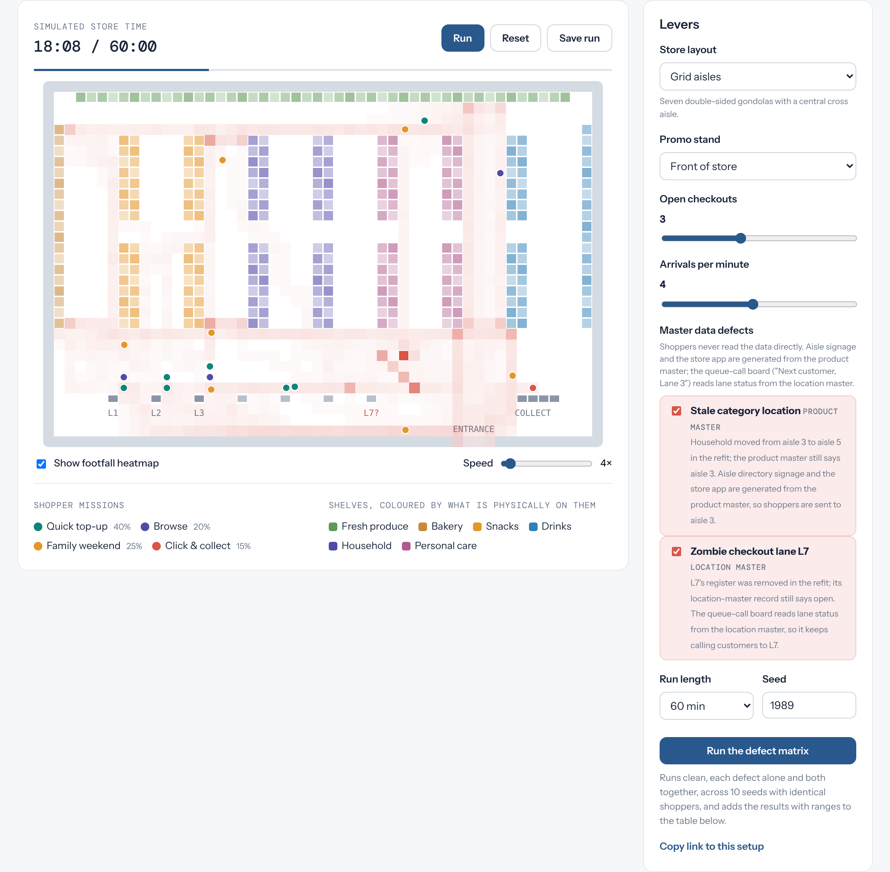

# The Swarm in the Store

**A browser swarm simulation of shoppers in a retail store, driven by governed master data.**

▶ **[Live demo](https://rajamdm.github.io/swarm-in-the-store/)** · 📖 **[The article](https://www.linkedin.com/pulse/swarm-store-raja-shahnawaz-soni-bozof/)**



Shoppers follow floor-level wayfinding built from the **location master**, head for the aisle the signage names, and react only to crowding in the cells around them. Nobody plans the queues, hotspots or walkouts: they emerge. Then you break the master data, one defect at a time, and measure what it costs.

> Emergence is only as true as the master data beneath it.

## The idea in one diagram

```
 SYSTEM OF RECORD (what the store believes)      PHYSICAL REALITY (what is on the floor)
 ├─ location-master.json  → queue-call board      ├─ planogram.json      (what is really on each fixture)
 ├─ product-master.json   → aisle signage / app   └─ pos-registers.json  (which lanes can really serve)
 └─ customer-segments.json → shopper behaviour
                     │                                              │
                     └──────── shoppers act on beliefs, collide with reality ────────┘
```

Shoppers never read JSON. Aisle signage and the store app are generated from the product master; the queue-call board ("Next customer, Lane 3") reads lane status from the location master. A master data defect is simply a system-of-record file that disagrees with reality. **The engine has no clean/dirty mode** (a test enforces it): defects are patches in `data/defects.json`, and their cost emerges from shoppers acting on bad information.

## What you can do

| Lever | What it changes |
| --- | --- |
| Store layout | Grid aisles or a racetrack loop |
| Promo stand | Front of store, an end-cap or the back wall, or none |
| Open checkouts | Shift plan: how many lanes with a register are staffed |
| Arrivals per minute | How busy the store is |
| **Master data defects** | **Toggle each independently** |
| Seed | Same seed, same shoppers, same result |

**Run the defect matrix** runs clean, each defect alone and both together, across 10 seeds with identical shoppers. It shows means with ranges, and reports automatically whether the defects add up, compound or mask each other.

### The defects

| Defect | System of record says | Reality | How it reaches shoppers |
| --- | --- | --- | --- |
| Stale category location | Product master: Household on aisle 3 | Planogram: moved to aisle 5 in the refit | Signage and app send shoppers to aisle 3 |
| Zombie checkout lane L7 | Location master: L7 open | No register installed | Queue-call board keeps calling customers to L7 |

### Two-tier governance

- **Tier 1, structural integrity** (blocks the run): grid geometry, every fixture in the planogram, every category stocked, aisle codes exist, everything reachable, segment shares sum to 100%.
- **Tier 2, operational sync** (warns): does the product master agree with the planogram? Is any lane open without a register?

With a defect on, Tier 1 stays green and Tier 2 turns amber. That is the point: **structurally valid data can still be operationally wrong**, and schema checks alone will not catch it.

## What the model found (10 seeds, grid layout, 3 lanes, 4 arrivals/min)

- **Stale aisle:** about 46 lost items and **$418/hr revenue at risk**. It also cut **promo reach from 64% to 38%**: Household shoppers used to pass the front-of-store stand on their way to aisle 5. A product-master error quietly broke a promotions KPI.
- **Zombie lane:** queue wait **26s → 62s**, about 104 dead-lane detours an hour, and walkouts appear. Under heavier load (2 lanes) walkouts roughly double.
- **Both together:** the defects **partly mask each other** on queue wait. The stale aisle pulls shoppers to the left of the store, near L1 to L3, so fewer of them reach L7. Fixing one defect can make the other look worse. That is emergence, and it is why defects need testing alone and together.

Prices are placeholders, and revenue at risk is shown per hour on purpose. Annualising an uncalibrated model into a "per store per year" figure would be false precision.

## How it works

```
data/
  location-master.json    store geometry, lane status, promo slots      (system of record)
  product-master.json     categories, aisle shown on signage, prices    (system of record)
  customer-segments.json  missions, speed, patience, impulse            (system of record)
  planogram.json          what is physically on each fixture            (reality)
  pos-registers.json      which lanes physically have a register        (reality)
  defects.json            defects as patches to system-of-record files
src/
  engine.js     DOM-free simulation and two-tier validation
  defects.js    applies defect patches to copies of the masters
  renderer.js   canvas drawing
  app.js        levers, live metrics, defect matrix
tests/engine.test.mjs   19 tests, Node's built-in runner, zero dependencies
```

- **Navigation:** breadth-first distance maps act as floor-level wayfinding. Each tick, a shopper picks among its four neighbouring cells using that map plus local crowding. Blocked shoppers sidestep, then squeeze through. Navigation is global; crowd behaviour is local.
- **Walkouts:** each segment has a patience threshold. If the best queue is longer, the shopper abandons the basket. Queueing at a dead lane halves patience.
- **Fair comparisons:** separate seeded streams for arrivals, shopper profiles and behaviour, so every scenario faces the same customers.
- **Unbiased averages:** shoppers still in the store count towards time and wait, so gridlock cannot hide behind survivorship bias.
- **Shareable:** every setting, including active defects, lives in the URL.

## Run it locally

No build step and no dependencies. ES modules need a local server (opening `index.html` from disk will not load the data):

```bash
git clone https://github.com/RajaMDM/swarm-in-the-store.git
cd swarm-in-the-store
python3 -m http.server 8000      # then open http://localhost:8000
npm test                         # Node 20+
```

## Honest limits

- **Illustrative, not calibrated.** Arrival rates, dwell times and service times are plausible defaults, not measurements from a real store. Calibrate against footfall sensors and POS data before using numbers in a decision.
- **Grid movement.** Shoppers move cell to cell (about 1 m, 1 second per tick). Good enough for congestion patterns, not for fine-grained pedestrian dynamics.
- **Simplified behaviour.** Shoppers who reach a wrong aisle either find the item (55%) or give up; there is no asking staff, substitution or app re-routing. Patience is a single queue-length threshold.
- **Defects can look like they help one metric.** The stale aisle slightly lowers queue wait in some runs, because shoppers finish in a different part of the store. The cost shows up in lost items and revenue instead. Read the whole row, not one cell.
- All names and data are fictitious.

## Built by

**Raja Shahnawaz Soni** · Enterprise data management practitioner · [LinkedIn](https://www.linkedin.com/in/raja-shahnawaz/) · [GitHub](https://github.com/RajaMDM)

*Built, not described.* MIT licensed.
